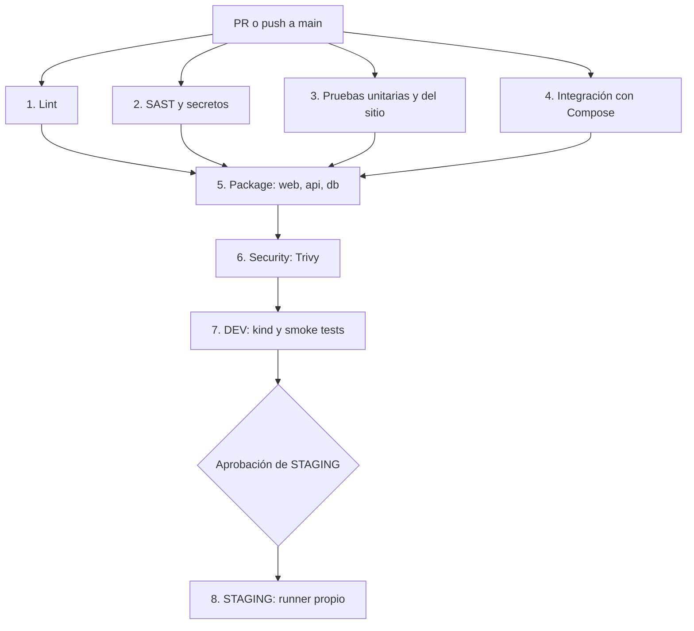

# LAB-04 | Pipeline CI/CD end-to-end

[](https://github.com/ConnieDR8/demo-cicd/actions/workflows/ci-cd.yml)

**Curso:** IF-1116 · Tópicos de Tecnologías de Información · 2026-II
**Repositorio:** [ConnieDR8/demo-cicd](https://github.com/ConnieDR8/demo-cicd)
**Workflow:** [`.github/workflows/ci-cd.yml`](.github/workflows/ci-cd.yml)

## Objetivo y arquitectura

Automatizar la validación, el análisis de seguridad, las pruebas, la publicación de imágenes y el despliegue de un **libro de visitas** con tres servicios:

| Servicio | Tecnología | Responsabilidad |
| --- | --- | --- |
| `web` | Nginx sin privilegios | Publica la página y redirige `/api/` al backend |
| `api` | Node.js 22, Express | Gestiona mensajes, estadísticas y métricas |
| `db` | PostgreSQL | Conserva los mensajes en almacenamiento persistente |

La API publica `GET /api/health`, `GET /api/mensajes`, `POST /api/mensajes`, `GET /api/estadisticas` y `/metrics`. La página muestra la cantidad de mensajes almacenados, obtenida desde PostgreSQL.

## B5 - Arquitectura del pipeline

El workflow se ejecuta para Pull Requests hacia `main`, para pushes a `main` y manualmente (`workflow_dispatch`). En Pull Requests termina en las verificaciones; **DEV y STAGING solo se despliegan con un push a `main`**.



### Etapas, herramientas y dependencias

| Etapa / job | Herramientas | Depende de | Comprobación principal |
| --- | --- | --- | --- |
| `lint` | ESLint, HTML-Validate, Hadolint | — | Calidad del JS, HTML y Dockerfiles |
| `sast` | Semgrep, TruffleHog | — | Patrones inseguros y secretos |
| `test-unit` | Vitest, jsdom, Supertest | — | Lógica de la API y del frontend |
| `test-integration` | Docker Compose, Vitest | — | Funcionamiento conjunto de web, API y base de datos |
| `package` (matriz de 3) | Buildx, QEMU, GHCR | `lint`, `sast`, `test-unit`, `test-integration` | Publicación de imágenes `web`, `api` y `db` |
| `security` (matriz de 3) | Trivy | `package` | Vulnerabilidades `CRITICAL` y `HIGH` corregibles |
| `deploy-dev` | kind, Kubernetes, Kustomize | `security` | Rollout, smoke e integración en entorno efímero |
| `deploy-staging` | Rancher Desktop, runner Windows | `deploy-dev` | Despliegue persistente con aprobación manual |

**Paralelismo B6:** `lint`, `sast`, `test-unit` y `test-integration` empiezan en paralelo. `package` espera que las cuatro etapas aprueben; luego se ejecutan las matrices de empaquetado y seguridad. Las pruebas siguen siendo obligatorias.

### Seguridad y control de cambios

- La rama `main` está protegida con PR y checks obligatorios.
- Las GitHub Actions usan referencias fijadas por SHA.
- Trivy usa `severity: CRITICAL,HIGH`, `ignore-unfixed: true` y `exit-code: "1"`.
- Para PostgreSQL existe una excepción específica documentada de `gosu`, acompañada por una comprobación del reemplazo por `su-exec`; no se desactiva el análisis general.
- [Dependabot](.github/dependabot.yml) revisa semanalmente acciones, paquetes npm del proyecto y API, y Dockerfiles.
- En B2 se sustituyeron HTMLHint por **HTML-Validate** y Gitleaks por **TruffleHog**.

### Imágenes y ambientes

Las imágenes se publican en GHCR como `ghcr.io/conniedr8/demo-cicd-{web,api,db}` con la etiqueta `sha-<commit>`. Buildx genera variantes `linux/amd64` y `linux/arm64` y reutiliza caché de GitHub Actions.

**DEV:** se crea un clúster temporal con `kind`, en el namespace `demo-dev`; valida el rollout, smoke tests y pruebas de integración. No conserva el estado entre ejecuciones independientes.

**STAGING:** funciona en Rancher Desktop con el namespace `demo-staging`, un runner Windows `self-hosted`, aprobación mediante GitHub Environments y volumen persistente de PostgreSQL. Su interfaz está disponible localmente en `http://localhost:30080` cuando el clúster está encendido.

### Reportes automáticos

Cada uno de los ocho jobs contiene un paso **Resumen B5** con `if: always()` que escribe en `GITHUB_STEP_SUMMARY`: etapa, estado, commit, número de ejecución y servicio cuando corresponde a una matriz. Estos reportes se consultan en el resumen de los jobs dentro de [GitHub Actions](https://github.com/ConnieDR8/demo-cicd/actions/workflows/ci-cd.yml). Los fallos se investigan mediante sus logs.

## Ejecución y pruebas locales

**Requisitos:** Git, Node.js 22, npm y Docker Compose.

En **PowerShell**, desde la raíz del repositorio:

```powershell
Copy-Item .env.example .env
# Editar .env y definir una contraseña segura antes de iniciar
npm ci
npm ci --prefix api
npm run lint
npm run test:unit
npm run test:site
docker compose up -d --build --wait
npm run test:integration
Start-Process http://localhost:8080
```

Para detener los servicios conservando los datos del volumen:

```powershell
docker compose down
```

El perfil `observabilidad` ofrece Prometheus en `http://localhost:9090` y Grafana en `http://localhost:3001` al ejecutarse con `docker compose --profile observabilidad up -d --build --wait`.

## Evidencias del laboratorio

- [Historial de CI/CD](https://github.com/ConnieDR8/demo-cicd/actions/workflows/ci-cd.yml)
- [Pull Requests y correcciones](https://github.com/ConnieDR8/demo-cicd/pulls?q=is%3Apr)
- [Documentación detallada de los fallos B3](docs/b3-evidencias.md)

La sección siguiente se conserva desde el README existente para mantener las **cuatro pruebas intencionales de B3**, con enlaces a ejecuciones rojas y verdes y sus minutos de detección.

## B3 - Cuatro fallos intencionales

Se introdujeron y corrigieron errores en cuatro etapas distintas del pipeline.

| Etapa | Qué se rompió | Run rojo | Run verde | Minuto de detección |
|---|---|---|---|---|
| Lint | Se eliminó `type="text"` de un input HTML | [#42](https://github.com/ConnieDR8/demo-cicd/actions/runs/41151300841) | [#43](https://github.com/ConnieDR8/demo-cicd/actions/runs/41151719558) | **Minuto 1 (14 s)** |
| Pruebas unitarias | Se cambió el alias SQL `total` por `cantidad` | [#45](https://github.com/ConnieDR8/demo-cicd/actions/runs/41152685867) | [#46](https://github.com/ConnieDR8/demo-cicd/actions/runs/41152816321) | **Minuto 1 (26 s)** |
| Integración | Se modificó el proxy de `api:3000` a `api:3001` | [#48](https://github.com/ConnieDR8/demo-cicd/actions/runs/41153692733) | [#49](https://github.com/ConnieDR8/demo-cicd/actions/runs/41153867655) | **Minuto 2 (67 s)** |
| SAST | Se cambió una acción fijada por SHA a `actions/checkout@v4` | [#51](https://github.com/ConnieDR8/demo-cicd/actions/runs/41155176229) | [#52](https://github.com/ConnieDR8/demo-cicd/actions/runs/41155262524) | **Minuto 1 (19 s)** |

Los tiempos se calcularon a partir de los logs de GitHub Actions, desde el inicio
del primer job hasta la detección del fallo, excluyendo la espera en cola.

### Conclusión

Tres errores se detectaron durante el primer minuto de ejecución.
El error de integración se detectó durante el segundo minuto porque fue
necesario levantar los contenedores antes de ejecutar las pruebas.

Esto demuestra la importancia de detectar defectos antes de las etapas
más costosas de construcción, escaneo y despliegue.

[Ver documentación detallada de B3](docs/b3-evidencias.md).

## B6 - Optimización del pipeline

**Objetivo:** reducir al menos un 25 % el tiempo de CI sin omitir análisis ni pruebas.

### Medición antes del cambio

Se mide desde la primera línea del primer job hasta la última línea del
último job de `security` en el log de GitHub Actions. Se excluyen las
esperas en cola, la aprobación humana y los despliegues DEV/STAGING.

| Ejecución de referencia | Tiempo CI hasta Security |
| --- | ---: |
| [#49](https://github.com/ConnieDR8/demo-cicd/actions/runs/41153867655) | 113,4 segundos |
| [#52](https://github.com/ConnieDR8/demo-cicd/actions/runs/41155262524) | 118,4 segundos |
| **Promedio anterior** | **115,9 segundos** |
| **Meta mínima (-25 %)** | **86,9 segundos o menos** |

### Optimización realizada

Antes: `lint` → `test-unit` → `test-integration`; `sast` en paralelo.

Después: `lint`, `sast`, `test-unit` y `test-integration` comienzan sin
esperar entre sí. `package` depende explícitamente de las cuatro etapas,
por lo que ninguna imagen se publica si alguna verificación falla.

Se conservan los mismos tests, Hadolint, Semgrep, TruffleHog, Trivy,
Buildx, el paso DEV y la aprobación de STAGING. Los jobs de pruebas
pueden terminar después de otra verificación fallida, pero no se publica
ni despliega código hasta que todos los controles obligatorios aprueben.

### Medición posterior

**Pendiente:** incorporar aquí el enlace al run de la PR B6 y su tiempo real
al finalizar `security`. La reducción se calculará como:

`Mejora (%) = (115,9 - tiempo_nuevo_en_segundos) / 115,9 * 100`

No se declara el objetivo cumplido hasta medir un run exitoso y comparar.
