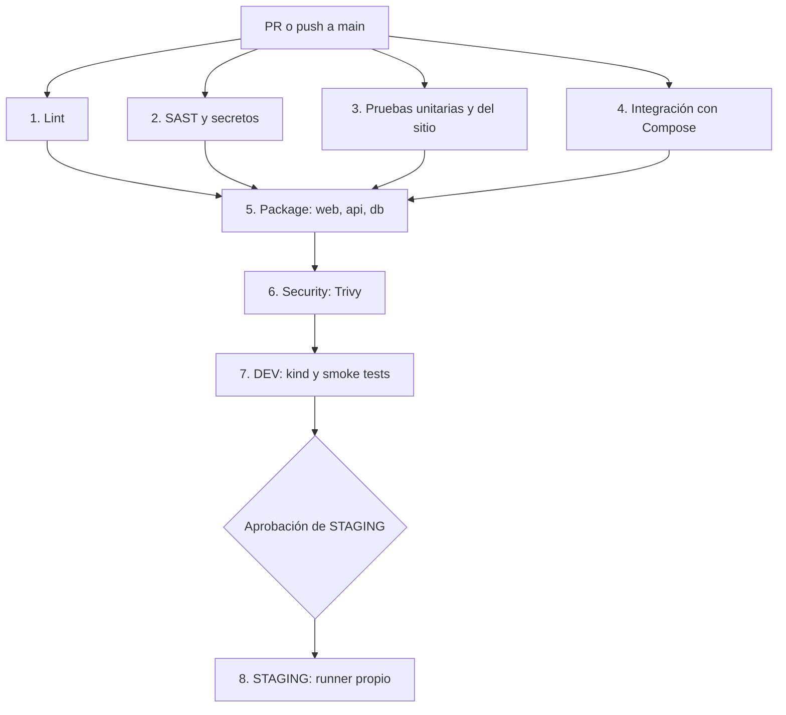

# LAB-04 | Pipeline CI/CD end-to-end

[](https://github.com/ConnieDR8/demo-cicd/actions/workflows/ci-cd.yml)

**Curso:** IF-1116 · Tópicos de Tecnologías de Información · 2026-II
**Repositorio:** [ConnieDR8/demo-cicd](https://github.com/ConnieDR8/demo-cicd)
**Workflow:** [`.github/workflows/ci-cd.yml`](.github/workflows/ci-cd.yml)

## Objetivo y arquitectura

Automatizar la validación, el análisis de seguridad, las pruebas, la publicación de imágenes y el despliegue de un **libro de visitas** con tres servicios:

| Servicio | Tecnología | Responsabilidad |
| --- | --- | --- |
| `web` | Nginx sin privilegios | Publica la página y redirige `/api/` al backend |
| `api` | Node.js 22, Express | Gestiona mensajes, estadísticas y métricas |
| `db` | PostgreSQL | Conserva los mensajes en almacenamiento persistente |

La API publica `GET /api/health`, `GET /api/mensajes`, `POST /api/mensajes`, `GET /api/estadisticas` y `/metrics`. La página muestra la cantidad de mensajes almacenados, obtenida desde PostgreSQL.

## B5 - Arquitectura del pipeline

El workflow se ejecuta para Pull Requests hacia `main`, para pushes a `main` y manualmente (`workflow_dispatch`). En Pull Requests termina en las verificaciones; **DEV y STAGING solo se despliegan con un push a `main`**.



### Etapas, herramientas y dependencias

| Etapa / job | Herramientas | Depende de | Comprobación principal |
| --- | --- | --- | --- |
| `lint` | ESLint, HTML-Validate, Hadolint | — | Calidad del JS, HTML y Dockerfiles |
| `sast` | Semgrep, TruffleHog | — | Patrones inseguros y secretos |
| `test-unit` | Vitest, jsdom, Supertest | — | Lógica de la API y del frontend |
| `test-integration` | Docker Compose, Vitest | — | Funcionamiento conjunto de web, API y base de datos |
| `package` (matriz de 3) | Buildx, QEMU, GHCR | `lint`, `sast`, `test-unit`, `test-integration` | Publicación de imágenes `web`, `api` y `db` |
| `security` (matriz de 3) | Trivy | `package` | Vulnerabilidades `CRITICAL` y `HIGH` corregibles |
| `deploy-dev` | kind, Kubernetes, Kustomize | `security` | Rollout, smoke e integración en entorno efímero |
| `deploy-staging` | Rancher Desktop, runner Windows | `deploy-dev` | Despliegue persistente con aprobación manual |

**Paralelismo B6:** `lint`, `sast`, `test-unit` y `test-integration` empiezan en paralelo. `package` espera que las cuatro etapas aprueben; luego se ejecutan las matrices de empaquetado y seguridad. Las pruebas siguen siendo obligatorias.

### Seguridad y control de cambios

- La rama `main` está protegida con PR y checks obligatorios.
- Las GitHub Actions usan referencias fijadas por SHA.
- Trivy usa `severity: CRITICAL,HIGH`, `ignore-unfixed: true` y `exit-code: "1"`.
- Para PostgreSQL existe una excepción específica documentada de `gosu`, acompañada por una comprobación del reemplazo por `su-exec`; no se desactiva el análisis general.
- [Dependabot](.github/dependabot.yml) revisa semanalmente acciones, paquetes npm del proyecto y API, y Dockerfiles.
- En B2 se sustituyeron HTMLHint por **HTML-Validate** y Gitleaks por **TruffleHog**.

### Imágenes y ambientes

Las imágenes se publican en GHCR como `ghcr.io/conniedr8/demo-cicd-{web,api,db}` con la etiqueta `sha-<commit>`. Buildx genera variantes `linux/amd64` y `linux/arm64` y reutiliza caché de GitHub Actions.

**DEV:** se crea un clúster temporal con `kind`, en el namespace `demo-dev`; valida el rollout, smoke tests y pruebas de integración. No conserva el estado entre ejecuciones independientes.

**STAGING:** funciona en Rancher Desktop con el namespace `demo-staging`, un runner Windows `self-hosted`, aprobación mediante GitHub Environments y volumen persistente de PostgreSQL. Su interfaz está disponible localmente en `http://localhost:30080` cuando el clúster está encendido.

### Reportes automáticos

Cada uno de los ocho jobs contiene un paso **Resumen B5** con `if: always()` que escribe en `GITHUB_STEP_SUMMARY`: etapa, estado, commit, número de ejecución y servicio cuando corresponde a una matriz. Estos reportes se consultan en el resumen de los jobs dentro de [GitHub Actions](https://github.com/ConnieDR8/demo-cicd/actions/workflows/ci-cd.yml). Los fallos se investigan mediante sus logs.

## Ejecución y pruebas locales

**Requisitos:** Git, Node.js 22, npm y Docker Compose.

En **PowerShell**, desde la raíz del repositorio:

```powershell
Copy-Item .env.example .env
# Editar .env y definir una contraseña segura antes de iniciar
npm ci
npm ci --prefix api
npm run lint
npm run test:unit
npm run test:site
docker compose up -d --build --wait
npm run test:integration
Start-Process http://localhost:8080
```

Para detener los servicios conservando los datos del volumen:

```powershell
docker compose down
```

El perfil `observabilidad` ofrece Prometheus en `http://localhost:9090` y Grafana en `http://localhost:3001` al ejecutarse con `docker compose --profile observabilidad up -d --build --wait`.

## Evidencias del laboratorio

- [Historial de CI/CD](https://github.com/ConnieDR8/demo-cicd/actions/workflows/ci-cd.yml)
- [Pull Requests y correcciones](https://github.com/ConnieDR8/demo-cicd/pulls?q=is%3Apr)
- [Documentación detallada de los fallos B3](docs/b3-evidencias.md)

La sección siguiente se conserva desde el README existente para mantener las **cuatro pruebas intencionales de B3**, con enlaces a ejecuciones rojas y verdes y sus minutos de detección.

## B3 - Cuatro fallos intencionales

Se introdujeron y corrigieron errores en cuatro etapas distintas del pipeline.

| Etapa | Qué se rompió | Run rojo | Run verde | Minuto de detección |
|---|---|---|---|---|
| Lint | Se eliminó `type="text"` de un input HTML | [#42](https://github.com/ConnieDR8/demo-cicd/actions/runs/41151300841) | [#43](https://github.com/ConnieDR8/demo-cicd/actions/runs/41151719558) | **Minuto 1 (14 s)** |
| Pruebas unitarias | Se cambió el alias SQL `total` por `cantidad` | [#45](https://github.com/ConnieDR8/demo-cicd/actions/runs/41152685867) | [#46](https://github.com/ConnieDR8/demo-cicd/actions/runs/41152816321) | **Minuto 1 (26 s)** |
| Integración | Se modificó el proxy de `api:3000` a `api:3001` | [#48](https://github.com/ConnieDR8/demo-cicd/actions/runs/41153692733) | [#49](https://github.com/ConnieDR8/demo-cicd/actions/runs/41153867655) | **Minuto 2 (67 s)** |
| SAST | Se cambió una acción fijada por SHA a `actions/checkout@v4` | [#51](https://github.com/ConnieDR8/demo-cicd/actions/runs/41155176229) | [#52](https://github.com/ConnieDR8/demo-cicd/actions/runs/41155262524) | **Minuto 1 (19 s)** |

Los tiempos se calcularon a partir de los logs de GitHub Actions, desde el inicio
del primer job hasta la detección del fallo, excluyendo la espera en cola.

### Conclusión

Tres errores se detectaron durante el primer minuto de ejecución.
El error de integración se detectó durante el segundo minuto porque fue
necesario levantar los contenedores antes de ejecutar las pruebas.

Esto demuestra la importancia de detectar defectos antes de las etapas
más costosas de construcción, escaneo y despliegue.

[Ver documentación detallada de B3](docs/b3-evidencias.md).

## B6 - Optimización del pipeline

**Objetivo:** reducir al menos un 25 % el tiempo de CI sin omitir análisis ni pruebas.

### Medición antes del cambio

Se mide desde la primera línea del primer job hasta la última línea del
último job de `security` en el log de GitHub Actions. Se excluyen las
esperas en cola, la aprobación humana y los despliegues DEV/STAGING.

| Ejecución de referencia | Tiempo CI hasta Security |
| --- | ---: |
| [#49](https://github.com/ConnieDR8/demo-cicd/actions/runs/41153867655) | 113,4 segundos |
| [#52](https://github.com/ConnieDR8/demo-cicd/actions/runs/41155262524) | 118,4 segundos |
| **Promedio anterior** | **115,9 segundos** |
| **Meta mínima (-25 %)** | **86,9 segundos o menos** |

### Optimización realizada

Antes: `lint` → `test-unit` → `test-integration`; `sast` en paralelo.

Después: `lint`, `sast`, `test-unit` y `test-integration` comienzan sin
esperar entre sí. `package` depende explícitamente de las cuatro etapas,
por lo que ninguna imagen se publica si alguna verificación falla.

Se conservan los mismos tests, Hadolint, Semgrep, TruffleHog, Trivy,
Buildx, el paso DEV y la aprobación de STAGING. Los jobs de pruebas
pueden terminar después de otra verificación fallida, pero no se publica
ni despliega código hasta que todos los controles obligatorios aprueben.

### Medición posterior

| Métrica | Resultado |
| --- | ---: |
| [Run #56 optimizado](https://github.com/ConnieDR8/demo-cicd/actions/runs/41158313429) | 83,5 segundos |
| Promedio inicial | 115,9 segundos |
| Reducción absoluta | 32,4 segundos |
| **Reducción porcentual** | **27,9 %** |
| Reducción requerida | 25 % |
| **Objetivo** | **Cumplido** |

La medición utiliza el mismo intervalo que la línea base:
desde el inicio del primer job hasta terminar el último escaneo
de Security, excluyendo esperas en cola y despliegues.

Las cuatro verificaciones iniciales se ejecutaron en paralelo.
Todos los checks obligatorios aprobaron y se conservaron los
controles de seguridad previos a la publicación y el despliegue.

**Conclusión:** la optimización redujo el tiempo de CI en un
27,9 %, superando la meta mínima del 25 %.

## B2 - Sustitución de herramientas

Se realizaron dos sustituciones respecto al pipeline inicial, sin retirar las verificaciones obligatorias:

| Control | Herramienta anterior | Herramienta incorporada | Evidencia |
| --- | --- | --- | --- |
| Lint de HTML | HTMLHint | HTML-Validate `10.17.0` | [PR #18](https://github.com/ConnieDR8/demo-cicd/pull/18) |
| Búsqueda de secretos | Gitleaks | TruffleHog `3.99.0` | [Run de CI exitoso](https://github.com/ConnieDR8/demo-cicd/actions/runs/41147588519) |

Los cambios están reflejados en `.htmlvalidate.json`, `package.json`, `package-lock.json` y `.github/workflows/ci-cd.yml`. Se mantienen ESLint, Hadolint y Semgrep.

## B4 - Cambio funcional de la aplicación

Se agregó la consulta `GET /api/estadisticas` para recuperar el total de mensajes almacenados y mostrarlo en el libro de visitas. El cambio amplió la funcionalidad del sistema y se incorporó mediante la [PR #19](https://github.com/ConnieDR8/demo-cicd/pull/19), conservando las pruebas automatizadas del pipeline.

## R1 - DAST con OWASP ZAP

Se incorporó **OWASP ZAP Baseline `2.17.0`** al job `deploy-dev` del workflow principal. Después del despliegue en `kind`, los smoke tests y las pruebas de integración, ZAP realiza un análisis pasivo contra la aplicación, genera `zap-report.html` y `zap-report.json`, y configura su publicación como artefactos de Actions. El script inspecciona el JSON y bloquea DEV si encuentra alertas de riesgo `HIGH` o superior.

- **Implementación:** [PR #27](https://github.com/ConnieDR8/demo-cicd/pull/27).
- **Evidencia de integración y checks de PR:** [Run 41165981664](https://github.com/ConnieDR8/demo-cicd/actions/runs/41165981664).
- **Alcance de la evidencia:** el run anterior aprobó CI, pero `deploy-dev` aparece **skipped** por ser una PR. Para afirmar que se ejecutó el escaneo real debe adjuntarse un run de `main` con el job DEV completado y el artefacto ZAP.

## R2 - Pipeline alternativo con GitLab CI

Se implementó `.gitlab-ci.yml` con etapas `test`, `build` y `deploy`: lint, pruebas unitarias y del sitio, integración con Docker-in-Docker, SAST, construcción/publicación de tres imágenes en GitLab Container Registry y despliegue de verificación efímero, activado manualmente. GitHub Actions sigue siendo el pipeline principal y el único que administra STAGING persistente.

- **Implementación:** [PR #28](https://github.com/ConnieDR8/demo-cicd/pull/28).
- **Refuerzo SAST:** [PR #31](https://github.com/ConnieDR8/demo-cicd/pull/31), con `.sast-analyzer: allow_failure: false`.
- **Evidencia del repositorio:** [Run 41171956549](https://github.com/ConnieDR8/demo-cicd/actions/runs/41171956549), que verifica CI de GitHub después de la corrección.
- **Límite:** ese run **no demuestra** la ejecución de GitLab CI. Siguen pendientes un pipeline real en GitLab.com, la publicación de imágenes en su Registry y la validación del job manual `deploy_validation`.

## R3 - Observabilidad de STAGING

Se incorporaron **Prometheus `v3.1.0` y Grafana `11.4.0`** al overlay `k8s/overlays/staging/observabilidad/`, administrado con Kustomize. Prometheus consulta `api:3000/metrics` cada 10 segundos; Grafana consume sus series y aprovisiona el dashboard `LAB04 - API RED / STAGING`, con solicitudes por segundo, errores 5xx, latencia p95 y disponibilidad de la API.

Los servicios son internos al clúster. La credencial administrativa se suministra desde el Secret `grafana-admin`, sin incluirla en Git, y se deshabilitó el acceso anónimo en Compose. El job `deploy-staging` verifica la existencia del Secret y el rollout de ambos componentes **después de la aprobación del entorno**.

- **Implementación:** [PR #29](https://github.com/ConnieDR8/demo-cicd/pull/29).
- **Correcciones de credenciales y estabilidad de Compose:** [PR #30](https://github.com/ConnieDR8/demo-cicd/pull/30).
- **Checks de PR:** [Run 41168605813](https://github.com/ConnieDR8/demo-cicd/actions/runs/41168605813) y [run 41171164851](https://github.com/ConnieDR8/demo-cicd/actions/runs/41171164851).
- **Verificación operativa pendiente de adjuntar:** run de `main` con `deploy-staging` aprobado, comprobación de `up{job="api"} == 1` y captura de los paneles con series reales. En los runs de PR, STAGING está omitido deliberadamente.

Para consultar los componentes con Rancher Desktop activo, usar terminales independientes:

```powershell
kubectl -n demo-staging port-forward svc/prometheus-r3 9090:9090
kubectl -n demo-staging port-forward svc/grafana-r3 3001:3000
```

## R4 - GitOps con Argo CD

Se instaló **Argo CD `v3.5.6`** en el namespace `argocd` y se registró la aplicación `demo-cicd-r4`, declarada en `k8s/gitops/application.yaml`. Observa exclusivamente la rama `main`, ruta `k8s/gitops/app`, y aplica los cambios al namespace `demo-gitops`. La política automatizada incluye sincronización, `prune` y `selfHeal`; no reemplaza ni modifica el mecanismo de aprobación de STAGING.

- **Implementación:** [PR #32](https://github.com/ConnieDR8/demo-cicd/pull/32).
- **Prueba de sincronización de contenido:** [PR #33](https://github.com/ConnieDR8/demo-cicd/pull/33).
- **CI asociado a la prueba:** [Run 41174347396](https://github.com/ConnieDR8/demo-cicd/actions/runs/41174347396); valida los cambios del repositorio, **no ejecuta Argo CD**.
- **Comprobación realizada en el clúster local:** aplicación `Synced` y `Healthy`; al escalar manualmente `r4-web` a dos réplicas, Argo CD restauró una. Después del merge de la PR #33 se comprobó que el HTML de la aplicación mostraba `Version 2: cambio sincronizado automaticamente desde GitHub`.

La evidencia del controlador es local; conservar las capturas de Argo CD y la salida de `kubectl` junto al enlace de la PR, sin presentar el run de CI como prueba de self-healing.

## R5 - Despliegue cloud externo con Render

Se publicó el libro de visitas fuera de la laptop mediante un Blueprint `render.yaml` en **Render**, con un servicio web Docker `demo-cicd-r5` y PostgreSQL administrado `demo-cicd-r5-db`, ambos configurados con plan `free`. Un servidor Express sirve frontend y API bajo el mismo dominio, prepara la tabla de mensajes y utiliza `DATABASE_URL` proporcionada por Render. Se deshabilitó el endpoint de métricas en el servidor público.

- **Aplicación:** https://demo-cicd-r5.onrender.com/
- **Infraestructura:** `render.yaml`, `r5-cloud/Dockerfile` y `api/cloud-server.js`.
- **Implementación:** [PR #34](https://github.com/ConnieDR8/demo-cicd/pull/34).
- **CI aprobado tras corregir Hadolint:** [Run 41176419865](https://github.com/ConnieDR8/demo-cicd/actions/runs/41176419865).
- **Prueba funcional realizada contra la URL pública:** frontend `HTTP 200`, salud de API `ok`, inserción de mensaje con ID `1` y posterior recuperación de ese mensaje desde PostgreSQL (`PERSISTENCIA VERIFICADA`). El enlace de CI demuestra calidad del código; la publicación y la persistencia se verificaron separadamente desde PowerShell.

La URL `https://TU-SERVICIO.onrender.com` era un marcador de ejemplo; se sustituyó por la URL real antes de realizar las pruebas de R5.

## R6 - Infraestructura como código con Terraform

Se incorporó `infra/r6/` con **Terraform `1.16.6`** y el proveedor Kubernetes `3.4.0`, fijados mediante `.terraform.lock.hcl`. Terraform administra **cuatro recursos** exclusivamente en `demo-iac-r6`: Namespace, ConfigMap, Deployment y Service. El estado permanece local y está excluido de Git mediante `.gitignore`.

El workflow independiente `.github/workflows/r6-terraform.yml` valida `fmt`, `init` y `validate` sin usar credenciales del clúster ni ejecutar `apply` desde GitHub Actions.

- **Implementación:** [PR #35 fusionada](https://github.com/ConnieDR8/demo-cicd/pull/35).
- **Terraform CI exitoso:** [Run 41178812516](https://github.com/ConnieDR8/demo-cicd/actions/runs/41178812516).
- **CI/CD principal exitoso:** [Run 41178812437](https://github.com/ConnieDR8/demo-cicd/actions/runs/41178812437).
- **Prueba local inicial:** `Apply complete! Resources: 4 added, 0 changed, 0 destroyed`, pod `1/1 Running` y Deployment disponible.
- **Prueba de desviación:** se escaló `r6-web` manualmente a dos réplicas; `terraform plan` detectó `2 -> 1`; `terraform apply` devolvió una réplica y el plan final respondió `No changes. Your infrastructure matches the configuration.`

El estado local de Terraform y el clúster Rancher Desktop se conservan para demostrar las pruebas; **no ejecutar `terraform destroy`** antes de guardar evidencias.

## Bitácora de decisiones - B2 y retos R1 a R6

Cada entrada conserva el formato solicitado. **Interpretación de evidencias:** un run de PR en verde acredita las verificaciones que efectivamente corrieron, pero no los jobs DEV/STAGING omitidos ni los servicios externos. Cuando corresponde, se distinguen las pruebas locales y las pendientes.

### B2: Sustitución de herramientas del pipeline

- **Decisión:** cambié HTMLHint por HTML-Validate y Gitleaks por TruffleHog, manteniendo ESLint, Hadolint y Semgrep en el pipeline.
- **Alternativas que evalué:** **HTMLHint:** herramienta ligera y conocida (+), pero con reglas menos exigentes que las que necesitaba para validar HTML (-). **Gitleaks:** escáner de secretos consolidado y ejecutable en contenedor (+), pero su integración original requería configurar el acceso seguro al repositorio montado (-).
- **Por qué elegí esta:** HTML-Validate utiliza un conjunto de reglas recomendado y TruffleHog ofrece una acción integrada a GitHub Actions; ambas sustituciones permanecen automatizadas en cada PR.
- **Fuentes consultadas:** [HTML-Validate](https://html-validate.org/), [HTMLHint](https://htmlhint.com/), [TruffleHog](https://github.com/trufflesecurity/trufflehog), [Gitleaks](https://github.com/gitleaks/gitleaks).
- **Cómo lo verifiqué:** [run de Actions 41147588519](https://github.com/ConnieDR8/demo-cicd/actions/runs/41147588519) (CI exitoso) y [PR #18](https://github.com/ConnieDR8/demo-cicd/pull/18).
- **Qué no me funcionó:** el flujo inicial dependía de dos herramientas que decidí sustituir; aprendí a cambiar implementaciones sin eliminar controles de calidad ni relajar el resultado del job. No se atribuye a las herramientas originales un fallo no documentado.

### Reto 1: DAST con OWASP ZAP

- **Decisión:** incorporé ZAP Baseline en DEV, después de smoke tests, con reportes HTML/JSON y un control adicional que bloquea alertas `HIGH` o superiores.
- **Alternativas que evalué:** **Nuclei:** plantillas personalizables y cobertura amplia (+), pero exige gestionar plantillas y el alcance de las pruebas (-). **Nikto:** sencillo para revisar servidores web (+), pero menos integrado al esquema de análisis pasivo y artefactos que buscaba (-).
- **Por qué elegí esta:** el modo Baseline inspecciona pasivamente la aplicación ya desplegada y encaja en la etapa DEV sin introducir ataques activos.
- **Fuentes consultadas:** [ZAP Baseline Scan](https://www.zaproxy.org/docs/docker/baseline-scan/), [Nuclei](https://docs.projectdiscovery.io/tools/nuclei/overview), [Nikto](https://github.com/sullo/nikto).
- **Cómo lo verifiqué:** [run CI 41165981664](https://github.com/ConnieDR8/demo-cicd/actions/runs/41165981664) valida el cambio de código; **pendiente anexar run de `main`** con DEV y el artefacto ZAP para demostrar el escaneo efectivo.
- **Qué no me funcionó:** el run de PR no sirve como evidencia de DAST ejecutado porque `deploy-dev` se omite por diseño; aprendí a distinguir la validación de la configuración de la ejecución real del escáner.

### Reto 2: Pipeline alternativo con GitLab CI

- **Decisión:** definí un pipeline independiente `.gitlab-ci.yml` con tests, SAST, imágenes en Registry y despliegue manual efímero; mantuve GitHub Actions como CI/CD principal.
- **Alternativas que evalué:** **Jenkins:** gran capacidad de personalización (+), pero requiere alojar y mantener el servidor y plugins (-). **CircleCI:** servicio administrado y pipelines declarativos (+), pero añade otra integración y condiciones propias del servicio (-).
- **Por qué elegí esta:** GitLab CI permite expresar etapas equivalentes en YAML y demostrar portabilidad del flujo sin sustituir el despliegue STAGING del laboratorio.
- **Fuentes consultadas:** [GitLab CI/CD](https://docs.gitlab.com/ci/), [GitLab SAST](https://docs.gitlab.com/user/application_security/sast/), [Jenkins](https://www.jenkins.io/doc/), [CircleCI](https://circleci.com/docs/).
- **Cómo lo verifiqué:** [run 41171956549](https://github.com/ConnieDR8/demo-cicd/actions/runs/41171956549) verifica el repositorio tras el ajuste SAST; **no verifica GitLab**. Queda pendiente el enlace a un pipeline ejecutado en GitLab.com y a sus imágenes publicadas.
- **Qué no me funcionó:** en la versión inicial, la configuración heredada del analizador SAST podía tolerar fallos; lo corregí con `allow_failure: false` ([PR #31](https://github.com/ConnieDR8/demo-cicd/pull/31)). Aprendí que declarar jobs no reemplaza ejecutarlos ni registrar sus evidencias.

### Reto 3: Observabilidad con Prometheus y Grafana

- **Decisión:** agregué Prometheus, Grafana y un dashboard RED en STAGING, con métricas expuestas por la API y contraseña de administrador almacenada como Secret.
- **Alternativas que evalué:** **Grafana Cloud:** elimina la operación local de observabilidad (+), pero depende de un servicio externo y de sus límites de plan (-). **Datadog:** observabilidad administrada con numerosas integraciones (+), pero añade coste o límites de prueba y dependencia de terceros (-).
- **Por qué elegí esta:** Prometheus/Grafana funcionan dentro de Rancher Desktop, usan manifiestos versionados y mantienen las métricas del laboratorio bajo control local.
- **Fuentes consultadas:** [Configuración de Prometheus](https://prometheus.io/docs/prometheus/latest/configuration/configuration/), [Provisioning de Grafana](https://grafana.com/docs/grafana/latest/administration/provisioning/), [Grafana Cloud](https://grafana.com/products/cloud/).
- **Cómo lo verifiqué:** [run CI 41168605813](https://github.com/ConnieDR8/demo-cicd/actions/runs/41168605813) y [run 41171164851](https://github.com/ConnieDR8/demo-cicd/actions/runs/41171164851) aprobaron controles de PR. **Pendiente:** run de `main` con aprobación y despliegue STAGING, `up{job="api"} == 1` y captura del dashboard con métricas reales.
- **Qué no me funcionó:** el Compose inicial permitía contraseña de Grafana predeterminada y acceso anónimo; se eliminó esa configuración ([PR #30](https://github.com/ConnieDR8/demo-cicd/pull/30)). También se serializaron pruebas de integración para evitar conflictos de ejecución. Aprendí a tratar la configuración de observabilidad con los mismos criterios de seguridad que la aplicación.

### Reto 4: GitOps con Argo CD

- **Decisión:** configuré Argo CD con una aplicación que observa `main`, sincroniza manifiestos y corrige cambios manuales de la carga en `demo-gitops` mediante `selfHeal`.
- **Alternativas que evalué:** **Flux CD:** controlador GitOps declarativo y liviano (+), pero ofrece una experiencia de inspección distinta a la interfaz de Argo CD (-). **`kubectl apply` manual:** sencillo y conocido (+), pero no observa Git continuamente ni corrige desviaciones por sí solo (-).
- **Por qué elegí esta:** Argo CD permite mostrar visualmente `Synced/Healthy`, la sincronización automática y el retorno al estado deseado, sin cambiar STAGING.
- **Fuentes consultadas:** [Argo CD Automatic Sync](https://argo-cd.readthedocs.io/en/stable/user-guide/auto_sync/), [Flux](https://fluxcd.io/flux/), [kubectl](https://kubernetes.io/docs/reference/kubectl/).
- **Cómo lo verifiqué:** [run CI 41174347396](https://github.com/ConnieDR8/demo-cicd/actions/runs/41174347396) y [PR #33](https://github.com/ConnieDR8/demo-cicd/pull/33). La prueba funcional fue **local**, comprobando `Synced/Healthy`, la restauración de dos a una réplica y la aparición de la versión 2 del HTML tras el merge.
- **Qué no me funcionó:** validar únicamente una PR no activa la sincronización, ya que Argo CD sigue `main`; aprendí a esperar el merge y verificar el estado tanto en la UI como dentro del pod.

### Reto 5: Despliegue cloud con Render

- **Decisión:** desplegué la aplicación completa con Docker y PostgreSQL administrado mediante un Blueprint gratuito de Render, partiendo del repositorio público.
- **Alternativas que evalué:** **Koyeb:** despliegue administrado y menos operación del servidor (+), pero requiere otra configuración de servicios y base de datos (-). **VPS administrado por mí:** control total del entorno (+), pero más mantenimiento, seguridad y posibles costes (-).
- **Por qué elegí esta:** Render admite infraestructura declarativa en `render.yaml`, conexión administrada a PostgreSQL y una URL HTTPS pública sin autorizar una aplicación GitHub para leer el repositorio público.
- **Fuentes consultadas:** [Render Blueprint specification](https://render.com/docs/blueprint-spec), [Despliegues Docker en Render](https://render.com/docs/docker), [Koyeb](https://www.koyeb.com/docs), [Terraform vs administración manual](https://developer.hashicorp.com/terraform/intro).
- **Cómo lo verifiqué:** [run CI 41176419865](https://github.com/ConnieDR8/demo-cicd/actions/runs/41176419865) (imagen y controles de PR) y prueba desde PowerShell contra [la URL pública](https://demo-cicd-r5.onrender.com/): `HTTP 200`, API `ok`, inserción y lectura persistente de un mensaje.
- **Qué no me funcionó:** Hadolint rechazó el formato inicial de `HEALTHCHECK` (DL3025); se corrigió a `CMD` exec-form ([commit de corrección](https://github.com/ConnieDR8/demo-cicd/commit/d6cf0c07e1c3f556a040453c235c6416ecab47bb)). La URL de ejemplo `TU-SERVICIO` también produjo una respuesta de servicio suspendido; aprendí a probar únicamente el dominio real.

### Reto 6: IaC con Terraform y Kubernetes

- **Decisión:** declaré Namespace, ConfigMap, Deployment y Service de `demo-iac-r6` en Terraform, y añadí un workflow de GitHub Actions para validar `fmt`, `init` y `validate` sin desplegar.
- **Alternativas que evalué:** **OpenTofu:** compatible con HCL y orientado a infraestructura declarativa (+), pero introduce otra distribución y conjunto de herramientas a instalar (-). **Pulumi con TypeScript:** permite programar IaC con tipos y reutilización de código (+), pero exige organizar dependencias y la ejecución del programa IaC (-).
- **Por qué elegí esta:** Terraform dispone de un proveedor Kubernetes, planes explícitos y comandos fáciles de evidenciar (`plan`, `apply`, comparación de estado); mantuve la infraestructura separada de R4.
- **Fuentes consultadas:** [Terraform Language](https://developer.hashicorp.com/terraform/language), [Proveedor Kubernetes](https://registry.terraform.io/providers/hashicorp/kubernetes/latest/docs), [OpenTofu](https://opentofu.org/docs/), [Pulumi](https://www.pulumi.com/docs/).
- **Cómo lo verifiqué:** [run Terraform 41178812516](https://github.com/ConnieDR8/demo-cicd/actions/runs/41178812516) y [run CI 41178812437](https://github.com/ConnieDR8/demo-cicd/actions/runs/41178812437), ambos exitosos; además, en Rancher Desktop `apply` creó los cuatro recursos y se verificó el ciclo `2 -> 1` réplicas y `No changes` final.
- **Qué no me funcionó:** WinGet instaló Terraform, pero la sesión de PowerShell no encontraba `terraform.exe` hasta corregir su `PATH`; la primera invocación de `plan -out` también dio error de argumentos y se ajustó. Aprendí a diagnosticar el entorno Windows antes de atribuir problemas al código IaC.

## Estado de evidencias para la entrega

| Entregable | Evidencia | Estado |
| --- | --- | --- |
| B2 | [Run CI de las sustituciones](https://github.com/ConnieDR8/demo-cicd/actions/runs/41147588519) | Verificado |
| B3 | [Cuatro fallos, runs rojos y verdes](docs/b3-evidencias.md) | Documentado |
| B4 | [PR funcional #19](https://github.com/ConnieDR8/demo-cicd/pull/19) | Implementado |
| B5 | [Workflow CI/CD](.github/workflows/ci-cd.yml) y sus resúmenes | Implementado |
| B6 | [Run #56 optimizado](https://github.com/ConnieDR8/demo-cicd/actions/runs/41158313429) | 27,9 % de reducción |
| R1 | [CI de PR](https://github.com/ConnieDR8/demo-cicd/actions/runs/41165981664) | Falta enlace a run DEV con ZAP ejecutado |
| R2 | [`.gitlab-ci.yml`](.gitlab-ci.yml) | Falta run real de GitLab.com |
| R3 | [CI de PR](https://github.com/ConnieDR8/demo-cicd/actions/runs/41168605813) | Falta run STAGING y capturas de métricas |
| R4 | [PR #33](https://github.com/ConnieDR8/demo-cicd/pull/33) y comprobaciones locales | Verificado localmente; conservar capturas |
| R5 | [Run CI](https://github.com/ConnieDR8/demo-cicd/actions/runs/41176419865) y [web pública](https://demo-cicd-r5.onrender.com/) | Verificado externamente |
| R6 | [Workflow Terraform exitoso](https://github.com/ConnieDR8/demo-cicd/actions/runs/41178812516) | Verificado en CI y Kubernetes local |

**B6 - fuente adicional de tiempos:** en GitHub, consultar **Insights → Actions** para comparar duraciones y complementar la medición ya registrada en este README. Los tiempos comparables de la sección B6 excluyen expresamente las esperas por aprobación humana y el despliegue.

**Criterio de honestidad documental:** no marcar como realizados los checks de GitLab, ZAP en DEV o paneles STAGING hasta contar con las ejecuciones y capturas correspondientes. Las PR muestran configuración y CI, no sustituyen las comprobaciones operativas.
